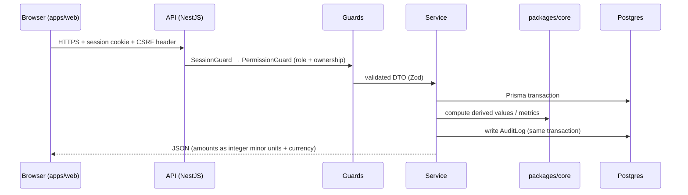
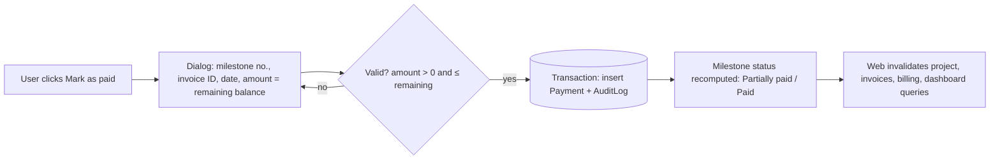

# 04 · Architecture

A pnpm + Turborepo **modular monolith**: one web app, one API, shared packages.

## Repository layout

```
apps/
  web/              React 19 SPA (dashboard, projects, invoices, billing)      port 5173
  api/              NestJS REST API                                             port 4000
packages/
  types/            Money (minor units) helpers, enums, shared TS types
  schemas/          Zod schemas for every request/response (used by web + api)
  core/             Pure business logic: milestone status, contract value, period maths, dashboard metrics
  database/         Prisma schema, migrations, client, seed
  auth/             Password hashing, session tokens, permission matrix
  ui/               shadcn/ui components + theme tokens + motion presets
  config/           Env loading and validation (server only)
  typescript-config/ Shared tsconfig presets (base, library, nest, react)
  eslint-config/    Shared ESLint flat configs (base, react)
tests/
  e2e/              Playwright end-to-end tests
scripts/            Security gates (see 11-security.md)
docs/               This folder
```

Dependency direction (never import upwards):

```
types → schemas → core → database → api
types → schemas → ui → web
auth → api
```

`packages/core` has **no I/O**: functions take plain data and return numbers, so every rule in
[06](06-business-rules.md) is unit-testable without a database.

## API modules (`apps/api/src/modules/*`)

| Module     | Responsibility                                                |
| ---------- | ------------------------------------------------------------- |
| auth       | Login, logout, session, password reset, invite acceptance     |
| users      | Invite, list, change role, deactivate (Admin)                 |
| clients    | CRUD, contacts, quick-create from project form                |
| projects   | CRUD, status changes, owner, upsell links, upsell entries     |
| milestones | CRUD within a project, reorder, derived status                |
| payments   | Mark as paid, edit invoice ID/date, reversal                  |
| documents  | Upload (signed PUT), list, download (signed GET), delete      |
| invoices   | Upcoming invoices / overdue list (read model over milestones) |
| dashboard  | KPIs, charts, team performance, exports                       |
| audit      | Audit log read (Admin)                                        |
| settings   | Company settings: base currency, FY start month, timezone     |

Cross-cutting (`apps/api/src/common`): session guard, CSRF guard, default-deny `@RequirePermission()` / `@Authenticated()`
guard, ownership helpers (`assertCanAccess`, `ownerWhere`), Zod pipe, error filter. Audit rows are written by an
explicit `AuditService.record(tx, …)` inside each business transaction (D-012), not an interceptor. Login rate
limiting lives in the auth service.

## Request flow



## Mark-as-paid flow



## Documents

1. Web asks API for an upload slot → API checks permission, returns a signed PUT URL (5 min) and a document id.
2. Browser uploads directly to the bucket. 3. Web confirms → API stores metadata (name, size, mime, key).
3. Download = API returns a signed GET URL (60 s). The bucket is never public.

## Environments

| Env        | Web             | API + DB                      | Files               |
| ---------- | --------------- | ----------------------------- | ------------------- |
| Local      | Vite dev server | Nest + local Postgres         | `./uploads`         |
| Staging    | Netlify/Vercel  | Render/Railway                | R2 bucket (staging) |
| Production | Netlify/Vercel  | Render/Railway, daily backups | R2 bucket (prod)    |

Production deploys are manual after CI passes (auto-deploy off).

## Same-origin API (D-011)

The web app always calls the relative path `/api/v1`. In development Vite proxies `/api` to `http://localhost:4000`;
in production the web host rewrites `/api/*` to the API (Netlify: `/api/* https://<api-host>/api/:splat 200`). Session
cookies are therefore first-party, `SameSite=Lax` works, and the API needs no CORS. The API trusts one proxy hop for
client IPs (`trust proxy = 1`).

## Time

- All timestamps stored in UTC. Dates without time (due date, payment date) stored as `DATE`.
- "Today", periods and overdue are computed in the company timezone from settings (default `Asia/Kolkata`).
