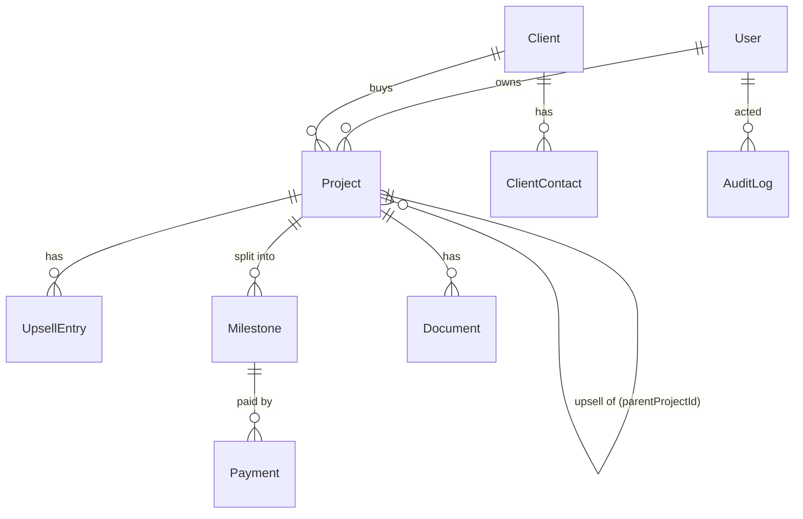

# 05 · Data model

Source of truth once built: `packages/database/prisma/schema.prisma`. Keep this doc in sync (gate-enforced).

## Entity map

## Conventions

- IDs: `cuid2` strings. Every table has `createdAt`, `updatedAt` (UTC), and `createdById` where a user creates it.
- **Money**: `BigInt` column holding **minor units** (paise/cents), named `…Minor` (e.g. `amountMinor`), plus a
  `currency` (ISO 4217). Never `Float`/`Decimal` in code paths. API sends money as a JSON integer (always within
  `Number.MAX_SAFE_INTEGER`) plus currency.
- Calendar dates (due date, payment date, start date) are `DATE`; instants are `TIMESTAMPTZ`.
- Soft delete (`archivedAt`) for clients and projects; **no delete** for payments.

## Entities

### User

| Field        | Type                         | Notes                                 |
| ------------ | ---------------------------- | ------------------------------------- |
| id           | string                       |                                       |
| name         | string                       |                                       |
| email        | string, unique, lowercased   | Login                                 |
| passwordHash | string?                      | argon2id; null until invite accepted  |
| role         | enum `ADMIN \| SALES \| CEO` | See [07](07-roles-and-permissions.md) |
| active       | boolean                      | Deactivated users cannot log in       |
| lastLoginAt  | timestamptz?                 |                                       |

`Session` (id hash, userId, expiresAt, ip, userAgent) and `Invite` (token hash, email, role, expiresAt) support auth.

### Client

| Field      | Type         | Notes                                                          |
| ---------- | ------------ | -------------------------------------------------------------- |
| id         | string       |                                                                |
| name       | string       | Required. Unique (case-insensitive) among non-archived clients |
| company    | string?      |                                                                |
| country    | string?      | ISO country code                                               |
| currency   | string       | Default currency for new projects; defaults to base currency   |
| notes      | text?        |                                                                |
| archivedAt | timestamptz? |                                                                |

### ClientContact

| Field     | Type    | Notes                          |
| --------- | ------- | ------------------------------ |
| clientId  | FK      |                                |
| name      | string? |                                |
| email     | string  | Validated email                |
| phone     | string? |                                |
| isPrimary | boolean | Exactly one primary per client |

### Project

| Field               | Type                    | Notes                                                   |
| ------------------- | ----------------------- | ------------------------------------------------------- |
| id                  | string                  |                                                         |
| code                | string, unique          | Human id, e.g. `PRJ-0042` (sequence)                    |
| name                | string                  |                                                         |
| description         | text                    |                                                         |
| clientId            | FK Client               |                                                         |
| ownerId             | FK User                 | The salesperson; defaults to creator                    |
| status              | enum (see 06)           | `LEAD, PROPOSAL, WON, ACTIVE, ON_HOLD, COMPLETED, LOST` |
| startDate           | date?                   |                                                         |
| durationValue       | int?                    | e.g. 3                                                  |
| durationUnit        | enum `WEEKS \| MONTHS`  |                                                         |
| endDate             | date? (derived, stored) | startDate + duration; recomputed on change              |
| expectedAmountMinor | bigint                  | Base deal value                                         |
| currency            | string                  | Fixed once any milestone exists                         |
| parentProjectId     | FK Project?             | Set when this project is an upsell of another           |
| wonAt               | date?                   | Set when status first becomes WON (editable by Admin)   |
| closedAt            | date?                   | Set when status becomes COMPLETED or LOST               |
| tags                | string[]                |                                                         |
| archivedAt          | timestamptz?            |                                                         |

### UpsellEntry

| Field       | Type   | Notes                         |
| ----------- | ------ | ----------------------------- |
| projectId   | FK     |                               |
| amountMinor | bigint | > 0                           |
| date        | date   | Counts as booked on this date |
| note        | text?  |                               |

### Milestone

| Field       | Type   | Notes                                                             |
| ----------- | ------ | ----------------------------------------------------------------- |
| projectId   | FK     |                                                                   |
| number      | int    | 1, 2, 3… shown as M1, M2; unique per project                      |
| title       | string | The "task"                                                        |
| description | text?  |                                                                   |
| amountMinor | bigint | > 0; cannot go below the amount already paid                      |
| dueDate     | date?  | Required before the project is ACTIVE; drives invoices & forecast |

Status is **derived**, never stored (rules in [06](06-business-rules.md#milestone-status)).

### Payment (Completed Billing row)

| Field             | Type        | Editable after save | Notes                                  |
| ----------------- | ----------- | ------------------- | -------------------------------------- |
| milestoneId       | FK          | no                  |                                        |
| milestoneLabel    | string      | **yes**             | Snapshot, defaults to `M{number}` (R5) |
| invoiceId         | string?     | **yes**             | From your invoicing tool               |
| paymentDate       | date        | **yes**             | Defaults to today                      |
| amountMinor       | bigint      | **no**              | Positive; negative only for a reversal |
| reversesPaymentId | FK Payment? | no                  | Set on reversal rows                   |
| note              | text?       | yes                 |                                        |
| createdById       | FK User     | no                  |                                        |

A database trigger rejects `UPDATE` of `amountMinor`, `milestoneId`, `reversesPaymentId` and any `DELETE`.

### Document

| Field        | Type    | Notes                                     |
| ------------ | ------- | ----------------------------------------- |
| projectId    | FK      |                                           |
| name         | string  | Original file name                        |
| type         | enum    | `PROPOSAL, SOW, CONTRACT, INVOICE, OTHER` |
| storageKey   | string  | Bucket key; never exposed                 |
| mimeType     | string  | Allow-list (see 11)                       |
| sizeBytes    | int     | ≤ 25 MB                                   |
| uploadedById | FK User |                                           |

### AuditLog

| Field    | Type        | Notes                                   |
| -------- | ----------- | --------------------------------------- |
| actorId  | FK User     |                                         |
| action   | string      | e.g. `payment.create`, `project.update` |
| entity   | string      | Table name                              |
| entityId | string      |                                         |
| before   | jsonb?      | Changed fields only                     |
| after    | jsonb?      |                                         |
| at       | timestamptz |                                         |
| ip       | string?     |                                         |

Append-only (trigger rejects update/delete).

### Setting (single row)

`baseCurrency` (default `INR`), `fyStartMonth` (default 4 = April), `timezone` (default `Asia/Kolkata`),
`dueSoonDays` (default 7), `companyName`.

## Derived values (computed in `packages/core`, never stored)

| Value               | Formula                                                               |
| ------------------- | --------------------------------------------------------------------- |
| contractValue       | `expectedAmount + Σ upsellEntries.amount`                             |
| scheduled           | `Σ milestones.amount`                                                 |
| unscheduled         | `contractValue − scheduled` (warn when ≠ 0 on ACTIVE projects)        |
| paid (milestone)    | `Σ payments.amount` (reversals are negative)                          |
| balance (milestone) | `amount − paid`                                                       |
| collected (project) | `Σ paid` over its milestones                                          |
| outstanding         | `Σ balance` over milestones with `dueDate ≤ today`                    |
| upsellValue         | `Σ upsellEntries.amount + Σ contractValue of child (upsell) projects` |

## Indexes

`Milestone(dueDate)`, `Payment(paymentDate)`, `Project(status, ownerId)`, `Project(wonAt)`, `Project(clientId)`,
`AuditLog(entity, entityId)`.
